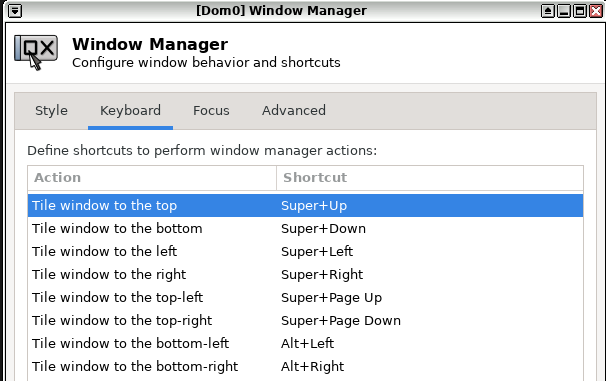

# Selecting what SEQS builds

The reviewed catalogue lives in `salt/pillar/seqs/config.sls` and is installed
unchanged under `/srv/pillar/seqs/config.sls`. Ordinary installation does not
require editing it. Select existing catalogue entries with a mandatory dom0
runner argument:

```bash
~/s.sh --build-only --qubes brave,signal,keepass
~/s.sh --build-only --all
```

To create an additional, independently named instance of every selected
catalogue recipe, add one postfix:

```bash
~/s.sh --build-only --qubes gnosisvpn,signal --postfix alpha
```

This creates `Z-gnosisvpn-alpha` / `A-gnosisvpn-alpha` and
`Z-signal-alpha` / `A-signal-alpha`. With `--all`, the postfix applies to the
entire catalogue. The postfix is part of the persistent instance name; use the
same command to converge that instance later.

Without `--postfix`, selecting an entry whose managed qubes already exist
reuses and reconciles them. SEQS prints an existing-qube message for each template and app qube,
never clones over them, and refuses a same-named qube it does not own. A
postfixed instance that already exists is handled identically.

Do not edit the staged `/srv` copy to select qubes. Editing the repository file
is an advanced operation for changing catalogue definitions or machine-wide
settings; those changes must go through fetch, review, and stage again.

## Changing a setting

Change a setting in the checkout in the download disposable, after verifying
its commit (README step 2) and before you install or upgrade. The runner
installs only committed files, so commit the change. For example, to turn off
`nuc11_headset_fix`, in the disposable's terminal:

```bash
cd ~/SEQS
sed -i 's/nuc11_headset_fix = True/nuc11_headset_fix = False/' salt/pillar/seqs/config.sls
git -c user.name=me -c user.email=me@localhost commit -qam 'Disable nuc11_headset_fix'
git show HEAD
```

`git show` should list only the lines you changed. Then continue with README
step 3 as usual. The runner now names your commit, whose parent is the commit
you verified. Repeat the change for every revision you fetch later: a build
from a revision without your change reverts it.

For an already installed machine, follow [the upgrade procedure](upgrading.md).
In particular, repository changes must be fetched into
`/var/lib/seqs/fetched`, staged under `/srv`, and then built.

The first-install guide covers the common selection-only case. This document
also describes advanced fields for an intentionally maintained custom fork or
machine-specific hardware configuration.

## Machine-wide settings

The top of `config.sls` sets values that apply to every qube:

| Setting | Default | Meaning |
| --- | --- | --- |
| `prefix_template`, `prefix_app`, `prefix_disposable` | `Z-`, `A-`, `D-` | Name prefixes of the templates, app qubes, and named disposables SEQS builds. The minion globs in `config.top` must match the first two; the pre-flight checks this. |
| `base_template` | `debian-13-xfce` | The template every SEQS template is cloned from. A change affects only templates cloned afterwards. |
| `browser_vm`, `browser_desktop` | `A-brave`, `open-links-in-browser-qube.desktop` | The qube that opens links handed off by other SEQS qubes, and the desktop entry in those qubes that hands them off; see [below](#browser-link-handoff-requires-a-brave). |
| `component_timeout` | `900` | Seconds one component may run before Salt stops it. |
| `sys_usb_memory` | `600` | Minimum memory of `sys-usb` in MiB; see [below](#sys_usb_memory). |
| `nuc11_headset_fix` | `True` | Makes the headset jack of an Intel NUC 11 Pro work, and does nothing on other computers; see [below](#nuc11_headset_fix). |
| `usb_keyboard_prompt` | `True` | Makes dom0 ask before a USB keyboard works where Qubes 4.3 refuses it; see [below](#usb_keyboard_prompt). |
| `dom0_launchers` | Qube Manager, Qubes Update, Screenshot, Terminal | Dom0 programs that get a launcher in the panel; see [Panel launchers](#panel-launchers). |
| `window_tiling_keys` | eight `Super` and `Alt` shortcuts | Keyboard shortcuts that tile the focused window; see [below](#window_tiling_keys). |
| `webcam_*` | QR transfer disabled | See [Secure QR USB modes](#secure-qr-usb-modes). |

## Components

Each qube in `qube_catalog` is built from a list of components. The catalogue
describes what the reviewed tree can build; it does not select every entry for
every run.

Staging always copies the complete reviewed tree. Consequently, changing only
the runtime selection does not change the staged-tree hash. The runner prints a
separate build-plan hash and records the canonical selection in
`/var/lib/seqs/last-run`.

The shipped catalogue currently exposes these base names:

```text
brave  element  telegram  signal  wireguard  gnosisvpn  protonvpn  anon
openoffice  xournalpp  usb-data-transfer  keepass  bluetooth  qr-display  qr-camera
qr-staging  claude-code  dev-full  wallet-ledger  wallet-trezor
```

Names are case-sensitive and must be passed without the generated `A-` or `Z-`
prefix. A postfix must also be a safe qube-name fragment; SEQS inserts the
separating `-`. A selection with a qube that hands links to the browser qube
needs `A-brave` too; see
[Browser-link handoff requires `A-brave`](#browser-link-handoff-requires-a-brave).

| Component | What it installs |
|---|---|
| `adb`          | Android Debug Bridge + `pv` (Debian apt) + chunked, resumable `/usr/bin/adb-pull` helper |
| `brave`        | Brave browser (apt repo; the downloaded keyring must hold exactly the pinned fingerprints); asks once per qube for a keyring password, which may be empty |
| `bitbox`       | BitBoxApp `.deb` (GPG-verified) |
| `bluetooth`    | BlueZ, PipeWire's Bluetooth plugin, the Qubes audio daemon, Blueman, and `pavucontrol` (Debian and Qubes apt) for a Bluetooth audio qube; see [bluetooth.md](bluetooth.md) |
| `claude-code`  | Claude Code (native installer) |
| `docker`       | Docker engine + persistent `/var/lib/docker` bind-dir |
| `element`      | Element chat (apt repo) |
| `gnosisvpn`    | GnosisVPN from its signed stable APT repository for `jura-prod`, persistent `/var/lib/gnosisvpn`, and dynamic Qubes DNS/fail-closed hooks |
| `keepass`      | KeePassXC AppImage (GPG-verified) |
| `ledger`       | Ledger udev rules + Ledger Live |
| `node`         | Node.js via nvm |
| `openoffice`   | Apache OpenOffice tarball (GPG-verified) |
| `protonvpn`    | Proton VPN app (Proton's apt repository, embedded verified key) and a fail-closed NetVM hook |
| `python`       | pyenv + Python |
| `qr-camera`    | `zbarcam` QR scanner + Qubes USB proxy for the offline camera DisposableVM template |
| `qr-display`   | `qrencode` for the offline QR-display DisposableVM template |
| `signal`       | Signal Desktop (apt repo, embedded verified key) |
| `telegram`     | Telegram via snap (`telegram-desktop`) |
| `trezor`       | Trezor udev rules |
| `vscode`       | Visual Studio Code |
| `wireguard`    | WireGuard tools and persistent, fail-closed NetVM hooks (Debian apt) |
| `xournalpp`    | Xournal++ (Debian package) |

## `qube_catalog` flags

Each entry is `{'name': ..., 'label': ..., 'components': [...]}` plus optional
flags; a duplicate name, a key not listed here, or a `True` flag set to
anything but `True` or `False` aborts the pre-flight. The label (window colour)
is one of red, orange, yellow, green, gray, blue, purple, or black. The flags:

- `'offline': True` — detaches the app qube from netvm (air gap) and unsets its
  default disposable, which would otherwise have network access. Implies
  `no_handoff`, and the runner re-verifies both after the dom0 apply. Use for
  wallet/vault qubes.
- `'no_handoff': True` — the qube can neither hand links to the browser qube
  nor open files in another qube or start a disposable, which would be
  networked and so another way out; copy files with `qvm-copy` instead. SEQS
  leaves the qube's link handler unset, and dom0 tags the qube
  `seqs-no-handoff` and denies by that tag, to every qube and disposable,
  `qubes.OpenURL`, `qubes.OpenInVM`, and the services that start a program in
  another qube or a disposable. Every build updates the tag on all SEQS app qubes and named
  disposables, selected or not, and disposables started from a tagged qube
  inherit it. A build that selects the qube also sets its default disposable
  to none, so a lost tag does not reopen that networked route.
- `'dispvm_template': True` — makes the app qube a DisposableVM template. The
  shipped offline `qr-display` and `qr-camera` entries use this flag; see
  [secure QR transfer](secure-qr-transfer.md). Every disposable template
  must also set `offline: True` or a `netvm` (enforced by pre-flight
  validation).
- `'named_disposable': True` — also creates a named DisposableVM (`D-<name>`,
  the `prefix_disposable`) from the `A-<name>` dispvm template, so the
  disposable is launchable from the Qubes menu rather than only appearing under
  "Templates". Requires `dispvm_template`; the shipped `qr-display` and `anon`
  entries use it. The named disposable gets the same NetVM as its template
  (none, or the `netvm` provider) and is reset on every shutdown, so nothing
  is provisioned inside it.
- `'network_provider': True` — enables `provides_network` and the
  `qubes-firewall` service on the app qube, allowing other qubes to select it
  as their NetVM. It cannot be combined with `offline` or `dispvm_template`.
- `'audio_provider': True` — makes the app qube an audio qube: other qubes
  whose `audiovm` names it play and record through it. dom0 enables its Qubes
  `audiovm` service, gives it no audio qube of its own, and lets it read
  through `/etc/qubes/policy.d/50-seqs-audiovm.policy` which qubes use it.
  Requires `offline` and cannot be combined with `dispvm_template`. The shipped
  `bluetooth` entry uses it; see [bluetooth.md](bluetooth.md).
- `'netvm': 'gnosisvpn'` — the app qube and its named disposable use the app
  qube of that catalogue entry (here `A-gnosisvpn`), which must set
  `network_provider`, as their NetVM, once that provider was provisioned
  successfully; until then they have none, and the app qube is not
  provisioned. The provider must be selected in the same build or already
  built successfully; a postfixed provider cannot be named, so a
  postfixed instance such as `anon-x` still uses the unpostfixed
  `A-gnosisvpn`, also with `--all --postfix x`. The
  shipped `anon` entry, a Brave disposable (`D-anon`), uses it. The runner
  re-verifies the NetVM after the dom0 apply. It cannot be combined with
  `offline` or `network_provider`.
- `'firewall': [...]` — an outbound allowlist for the app qube: each entry is a
  hostname or IPv4 address, `host:port` for one TCP port (1-65535), `'dns'`, or
  `'icmp'`, and all other traffic is dropped; the pre-flight refuses other
  ports and IPv4 octets above 255. Hostname entries also need `'dns'`, which
  allows lookups of any name, so DNS remains a channel out. Qubes enforces the
  rules in the qube's NetVM, which must run the `qubes-firewall` service
  (`sys-firewall` does); SEQS neither sets nor checks that NetVM. A build
  that selects the qube restores the list if its rules were changed by hand;
  removing the key and rebuilding restores the Qubes default (allow all). It
  cannot be combined with `offline`, or with `named_disposable`, whose
  disposable would not get the list. Because the allowlist does not restrict
  qrexec, it implies `no_handoff`, which closes link handoff and disposables
  and clears the qube's default disposable.
- `'preserve_incoming': True` — skips the boot and shutdown cleanup of
  [`cleanup_dirs`](#cleanup_dirs). The shipped
  `qr-staging` entry uses it to hold a received file while the computer is off.
- `'main_app': 'signal-desktop.desktop'` — the desktop file of the app the
  qube is for, as the qube's template installs it under
  `/usr/share/applications`. It is added to the qube's Qubes menu, and starts
  first in the qube's [panel launcher](#panel-launchers).
- `'vcpus': 4` — the app qube's number of virtual CPUs (the Qubes default is
  2); the shipped `gnosisvpn` entry uses 4. A running qube changes at its next
  start, and removing the key keeps the count. It cannot be combined with
  `cpu_pinning`, which sets the count itself.
- `'cpu_pinning': {'cpus': [0, 2], 'weight': 512}` — gives the app qube one
  vCPU per listed CPU, pins them to those CPUs, and optionally
  raises its Xen scheduler weight (1-65535; the default is 256). dom0 writes
  `/etc/qubes/templates/libvirt/xen/by-name/A-<name>.xml`, a per-qube addition
  to the Xen configuration that Qubes applies at every start, so a running
  qube changes at its next start. CPU numbers are Xen's, 0 to `nr_cpus` - 1
  as `xl info` in dom0 shows; for a selected qube the pre-flight refuses
  others, and refuses to overwrite such a file that SEQS did not write. Removing the key deletes the
  file; the vCPU count stays.

Removing `offline`, `no_handoff`, `firewall`, `dispvm_template`,
`network_provider`, or `audio_provider` from a built qube does not revert the
qube preferences (`qvm-prefs`) and services these flags set: a NetVM, default
disposable, or audio qube set to none stays none, and `template_for_dispvms`,
`provides_network`, or the `audiovm` service stays on (see
[convergence](architecture.md#convergence)).

## Panel launchers

A build adds one launcher to the dom0 XFCE panel for each app qube and named
disposable it builds, before the panel's first expanding separator. The
launcher's button starts the qube's `main_app` (without one, its terminal);
its arrow opens the qube's terminal and file manager. A disposable template gets none, because its
entries would run in the template instead of in a disposable. The build
needs to find a running XFCE panel of the user who runs it; otherwise it adds
no launchers and says so.

A rebuild refreshes the launcher's entries. A launcher removed from the panel
(right-click, **Remove**) stays removed; deleting the qube with
[`delete-vms.sh`](deleting-vms.md) removes its launcher too.

`dom0_launchers` lists dom0 programs by their menu entry under
`/usr/share/applications` in dom0, such as `qubes-qube-manager.desktop`. Each
gets a launcher of its own, in the listed order, right after the panel's
first item, the Qubes menu button. A build names an entry that dom0 does not
have and adds no launcher for it. A launcher removed from the panel stays
removed; an entry removed from the list loses its launcher at the next build,
and gets it back if it returns to the list.

## `window_tiling_keys`

This setting binds keyboard shortcuts that move the focused window to a half
or a quarter of the screen, as the **Keyboard** tab of dom0's **Window
Manager** settings does. It maps each shortcut, in the form that tab shows
with the modifier in angle brackets, to the xfwm4 action:

```jinja

```

The shipped map matches this view of the tab:



A build binds each shortcut in the custom key theme, copying xfwm4's default
theme into it first if the computer still uses the default; a shortcut that
was bound to another action is rebound. The window manager grabs these keys
before any window sees them, so `Alt+Left` and `Alt+Right` no longer reach
the programs in qubes, where browsers use them to go back and forward; choose
other shortcuts if you need those. An empty map binds nothing and leaves
earlier bindings in place. Like the panel launchers, this needs a running
XFCE session of the user who runs the build.

## WireGuard NetVM

The optional `wireguard` entry builds `A-wireguard`, a fail-closed
network-provider AppVM configured from a user-supplied WireGuard file. See
[Using the WireGuard NetVM](wireguard.md) for setup, verification,
troubleshooting, and a high-level explanation of its routing, DNS, persistence,
and firewall behavior.

## GnosisVPN NetVM preparation

The optional `gnosisvpn` entry builds `A-gnosisvpn`, installs Debian's
`wireguard-tools` and `openresolv`, installs GnosisVPN from its stable APT repository for
the `jura-prod` network, and configures reconciled Qubes-aware DNS with
tunnel-routed fallback resolvers and fail-closed forwarding hooks. See
[Using the GnosisVPN NetVM](gnosisvpn.md) for the scoped download path,
verification, and runtime checks.

## Proton VPN NetVM

The optional `protonvpn` entry builds `A-protonvpn`, a fail-closed
network-provider AppVM running the official Proton VPN app. See
[Using the Proton VPN NetVM](protonvpn.md).

## `sys_usb_memory`

Each build raises the memory of `sys-usb` (the Qubes qube that owns the USB
controllers and forwards USB devices to other qubes) to `sys_usb_memory` MiB if
it has less. It never lowers it, and `0` leaves `sys-usb` alone. The change
takes effect when `sys-usb` next starts, normally at the next boot, and the
memory is then reserved for as long as `sys-usb` runs.

With the 300 MiB that the Qubes installer usually gives `sys-usb`, a device
can drop in the middle of use, typically a webcam during a call. Forwarding a
device needs blocks of 128 KiB of contiguous memory in `sys-usb`; when it runs
short, the kernel refuses the allocation and the device disappears from the
qube it was attached to. On the
SEQS test machine, a 300 MiB `sys-usb` with 120 MiB of its memory taken lost
the webcam within a minute; with 600 MiB it kept it for the whole 10-minute
test.

To find out whether a lost device had this cause, run in a `sys-usb` terminal:

```bash
sudo dmesg | grep 'stub_rx: page allocation failure'
```

Any output means it did. The device then cannot be attached again until it is
replugged or released in the same terminal, with `4-1` replaced by the ID the
Qubes devices widget shows after `sys-usb:`:

```bash
echo 4-1 | sudo tee /sys/bus/usb/drivers/usbip-host/unbind
echo 4-1 | sudo tee /sys/bus/usb/drivers_probe
```

## `nuc11_headset_fix`

On an Intel NUC 11 Pro (models `NUC11PA...`), Linux sees neither the
microphone of a headset in the front jack nor that anything is plugged in, so
the dom0 volume control offers the headset neither for sound nor for calls.
The firmware leaves the jack's microphone connection unconfigured. With
`nuc11_headset_fix = True`, the default, each build on a NUC 11 installs
the same correction that the Linux kernel ships for the NUC 10, as two files
in dom0: `/lib/firmware/seqs-nuc11-headset.fw` and
`/etc/modprobe.d/seqs-nuc11-headset.conf`. It takes effect at the next boot.

On any other computer, and with `False`, each build removes both files
instead: the kernel would apply the correction to every audio chip of the
same type (Realtek ALC256), which many laptops use differently. The build
recognizes a NUC 11 by its audio codec, a Realtek ALC256 with Intel's
subsystem ID `0x80863004`.

After the next boot, the headset should appear as the output and input in the
dom0 volume control while it is plugged in.

## `usb_keyboard_prompt`

On a Qubes 4.3 computer installed with its built-in keyboard, Qubes refuses
keyboard input from `sys-usb` (the qube that owns the USB controllers) to
dom0, so a USB keyboard plugged in later does not work. With
`usb_keyboard_prompt` at `True`, each build writes
`/etc/qubes/policy.d/30-user-input.policy`, which makes dom0 ask before such a
keyboard works, as Qubes asks before a USB mouse works. A compromised
`sys-usb` can raise the same prompt, and once a keyboard or mouse prompt is
accepted it can type or click in dom0;
[TRUST.md](../TRUST.md#usb-keyboard-policy-override-qubesinputkeyboard-from-sys-usb--dom0-)
describes that risk. On a computer installed with a USB keyboard, the Qubes
installer allows the keyboard by policy, and this setting changes nothing.

Set it to `False`, as described in [Changing a setting](#changing-a-setting),
to keep Qubes' refusal, for example on the receiving computer of a
[sequential QR transfer](secure-qr-transfer-sequential.md) of a high-value
secret. Each build then removes the file it wrote earlier and writes no new
one, and no USB keyboard works in dom0. A build from a revision with `True`
writes the file again.

## Secure QR USB modes

`webcam_usb_mode` is `disabled` by default. After completing the qualification
test in [secure QR transfer](secure-qr-transfer.md#choose-the-hardware-isolation-path),
select `dedicated` for a webcam-only physical controller or `sequential` for
the reduced-assurance shared-controller ceremony. Both require a verified
physical `webcam_usb_controller` BDF. `webcam_usb_strict_reset` is `True` by
default, so Qubes resets the controller whenever it moves to the webcam qube.
Set it to `False` only for a sequential-mode controller without a PCI reset
method; dedicated mode refuses it, and every build stops if the setting does
not match the controller's reset methods. Sequential mode intentionally
powers off rather than restoring normal USB input in place, so the controller
returns to `sys-usb` only after a cold boot. The other `webcam_*` settings
name the qubes the transfer creates or uses (`webcam_usb_qube`,
`webcam_scanner_qube`, `webcam_normal_usb_qube`); change them only to avoid a
clash with an existing qube. The build refuses a `webcam_usb_qube` or
`webcam_scanner_qube` that names a qube SEQS builds for a catalogue entry
(built or not), the normal USB qube, or the other one of the two. The camera side's template and the qube that
receives the scan are always the catalogue's `qr-camera` and `qr-staging`
qubes.

## `brave_extensions`

Maps name → Chrome Web Store ID for each Brave wallet extension. Reference them
in qube specs as `brave-extension-<name>`; each such component installs or
updates Brave first.

- **Enable** an extension in a qube: add `brave-extension-<name>` to that qube's
  component list.
- **Add** a new extension (e.g. Ambire): add a `brave_extensions` line, then
  reference it as `brave-extension-ambire` in any wallet qube.
- **Retire** an extension entirely: remove every `brave-extension-<name>`
  reference, then its `brave_extensions` line. Templates already built keep it
  installed until you rebuild them.

## `cleanup_dirs`

Directories that app qubes and disposables delete at every boot and shutdown,
so downloads and received files do not accumulate; templates are never
cleaned. By default `~/QubesIncoming` is deleted (mode `folder`) and
`~/Downloads` is emptied (mode `contents`). A path must lie strictly under
`/home/user/`, use only `A-Z a-z 0-9 . _ / -`, and contain no `..`, `.`, or
empty segment; the pre-flight refuses others, because the cleanup runs
`rm -rf` as root.

## Browser-link handoff requires `A-brave`

The `seqs.dom0` state tags each SEQS qube without `offline`, `no_handoff`, or
`firewall` as `seqs-handoff`; the dom0 policy
`qubes.OpenURL * @tag:seqs-handoff A-brave allow` lets those open web links in
`browser_vm` (default `A-brave`) without a prompt. Other qubes keep the Qubes
default, which asks. Qubes with those flags never hand links off, so a run
that selects only such qubes (for example `keepass` or the wallets) does not
need the browser qube. For any other selected qube,
the pre-flight refuses a `browser_vm` that is neither selected in the same run
nor already existing. With `--postfix`, selecting `brave` builds
`A-brave-<postfix>`, which is not the browser qube, so the plain `A-brave` must
already exist. If you remove `brave` from `qube_catalog`, also change
`browser_vm` in `config.sls` to a browser qube you do have.

## Adding a new component

Create `install-scripts/components/<name>/` containing:

- an optional `template-vm.sh` — system-wide install in the template,
- an optional `app-vm.sh` — per-app-VM setup in `$HOME` / `/rw`,
- an optional `menu.desktop` — installed as
  `/usr/share/applications/<name>.desktop`.

The scripts run as `user` with `sudo` available, and each one is stopped after
`component_timeout` (900 seconds). A component runs again whenever its files or
the shared libraries in `install-scripts/lib/` change, so its scripts must be
safe to run twice.

Then reference `<name>` in any qube spec. If the component needs Brave, it can
`source "$(dirname "$0")/brave.sh"` and call `install_brave`.

After adding a component, also add it to the **Components** table above so the
documentation stays coherent with the on-disk components.
